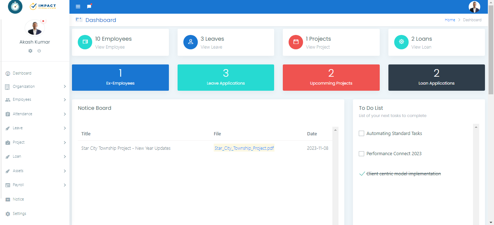
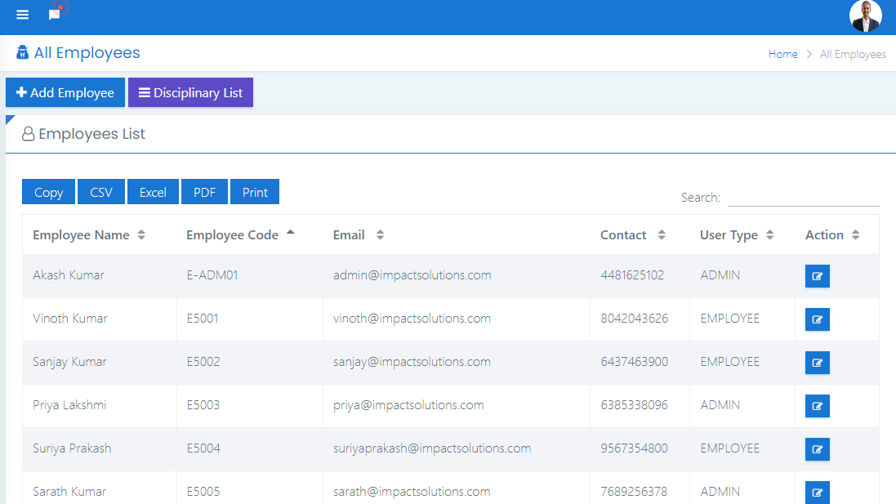
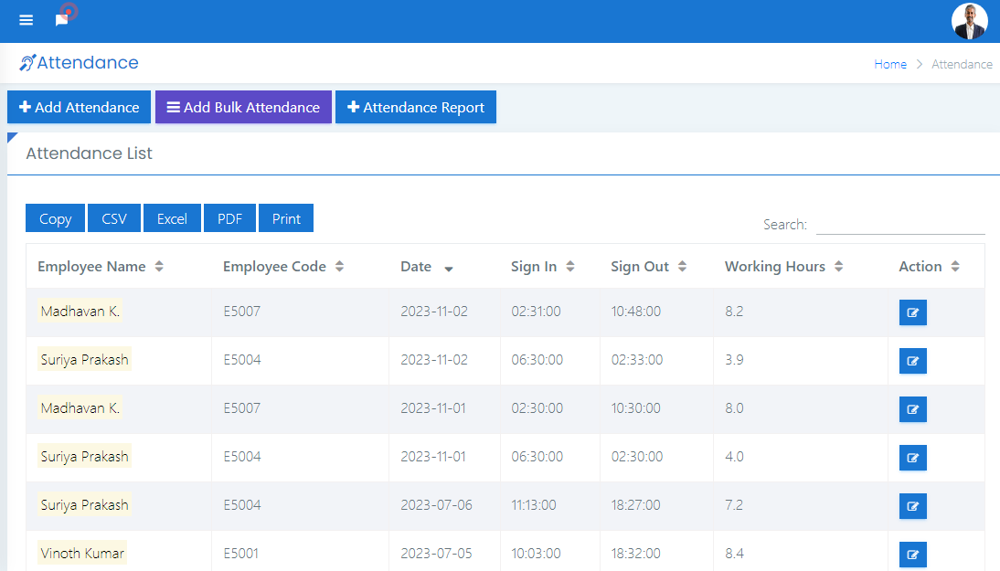
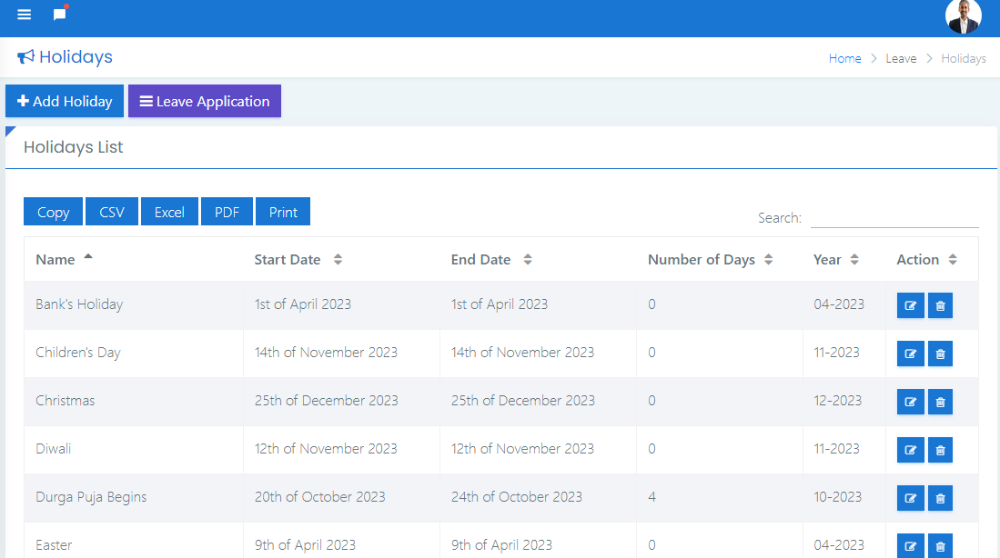
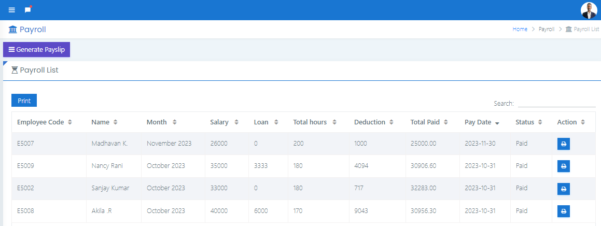
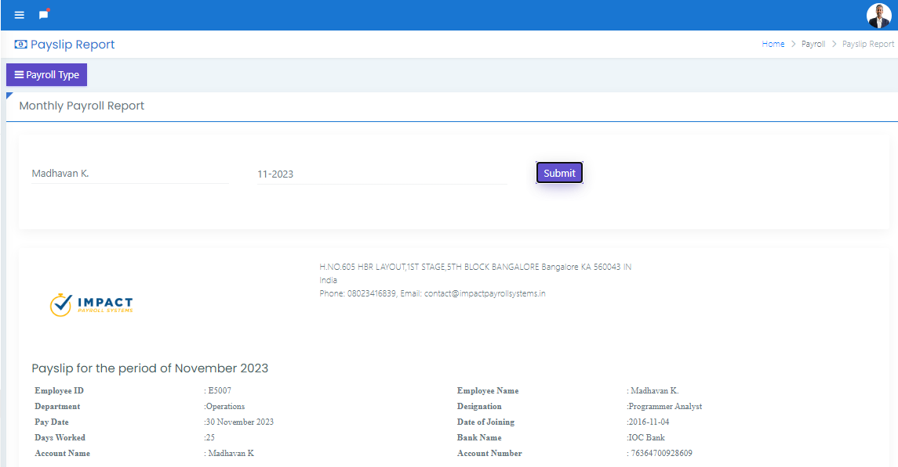
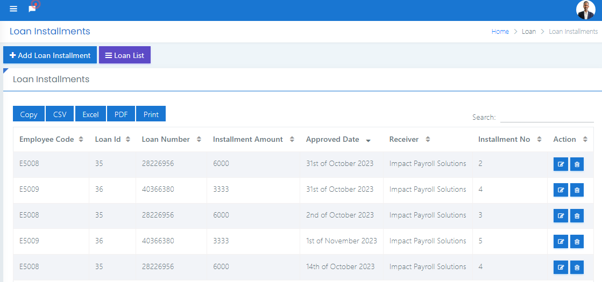
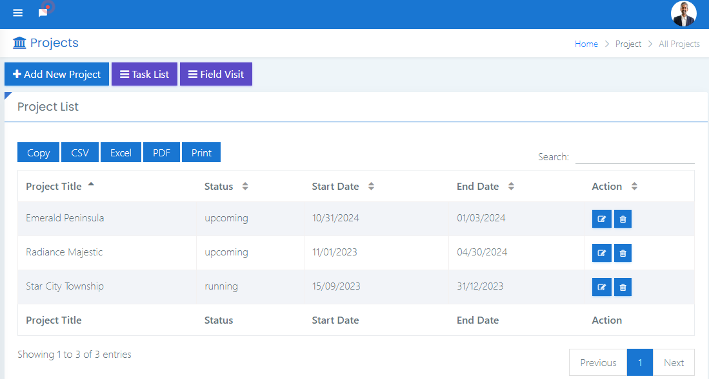
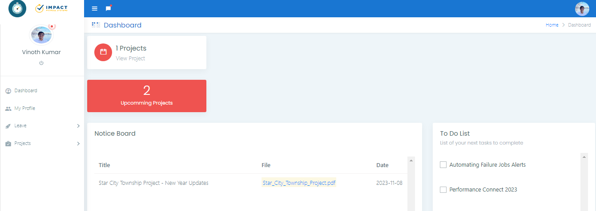
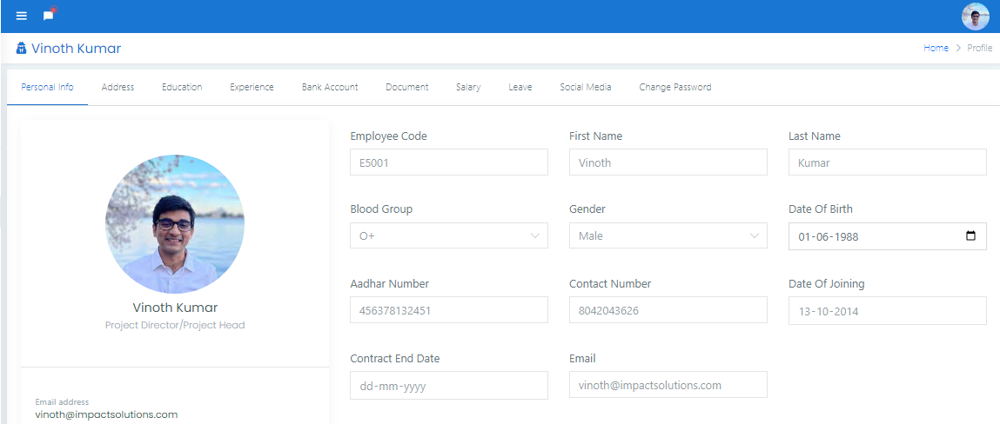

# Smart Payroll Management System

A web-based payroll and HR management system for small and mid-sized organisations. Admins manage employees, departments, attendance, leave, loans, company assets, projects and notices, and generate monthly payslips that are calculated from each employee's actual attendance. Employees get a self-service portal for their profile, leave applications and assigned projects.

Built with **PHP (CodeIgniter 3)**, **MySQL/MariaDB**, **Bootstrap**, **jQuery** and **AJAX**.



---

## Features

| Module | What it does |
|---|---|
| **Dashboard** | Summary of employees, leave requests, projects, loans, a notice board and a personal to-do list |
| **Organisation** | Departments and designations |
| **Employees** | Add / edit / deactivate employees; personal details, addresses, education, experience, bank info, documents, social links; disciplinary records |
| **Attendance** | Mark daily check-in / check-out, bulk import from CSV, per-employee attendance report |
| **Leave** | Yearly holiday calendar, leave types and quotas, apply / approve / reject, earned-leave balances, monthly leave report |
| **Payroll** | Salary structure (basic + additions − deductions), monthly payslip generation from worked hours vs. expected hours (holidays and weekly off-days excluded), automatic loan-instalment deduction, printable payslips and pay reports |
| **Loans** | Loan requests, approval, instalment schedule and tracking |
| **Assets & logistics** | Asset categories, stock, and assignment of assets to employees / projects |
| **Projects** | Projects, tasks, team assignment, field visits, notes, files and expenses |
| **Notices** | Company-wide announcements with attachments |
| **Settings** | Company name, logo, contact details, currency symbol |
| **Roles** | `ADMIN` (full access) and `EMPLOYEE` (self-service only), enforced server-side |

### How pay is calculated

```
working days   = days in month − public holidays − weekly off-days
expected hours = working days × 8
hourly rate    = monthly salary ÷ expected hours
difference     = expected hours − hours actually worked (from attendance)

net pay = monthly salary
          + overtime (if difference < 0)  = |difference| × hourly rate
          − shortfall (if difference > 0) = difference × hourly rate
          − loan instalment (if the employee has an active loan)
```

The weekly off-day is set by `WEEKLY_OFF_DAY` in [`application/config/constants.php`](application/config/constants.php) (default `7` = Sunday).

---

## Screenshots

| | |
|---|---|
|  Login |  Employees |
|  Attendance |  Holiday calendar |
|  Payroll list |  Payslip report |
|  Loan instalments |  Projects |
|  Employee dashboard |  Employee profile |

More in [`docs/screenshots`](docs/screenshots). A sample generated payslip is in [`docs/sample-payslip.pdf`](docs/sample-payslip.pdf).

---

## Getting started

### Requirements

- PHP **7.4 – 8.3** with the `mysqli` and `calendar` extensions (both are enabled in XAMPP by default)
- MySQL 5.7+ or MariaDB 10.3+
- Apache with `mod_rewrite` (XAMPP / WAMP / LAMP), or PHP's built-in server

### Run with XAMPP (Windows)

1. Clone the repository into `htdocs`:
   ```bash
   cd C:\xampp\htdocs
   git clone https://github.com/<your-username>/smart-payroll-management-system.git payroll
   ```
2. Start **Apache** and **MySQL** from the XAMPP control panel.
3. Create the database and load the demo data, either
   - in **phpMyAdmin** → *Import* → choose `database/payroll_db.sql`, or
   - from a terminal: `mysql -u root < database/payroll_db.sql`

   The script creates a database named **`payroll_db`**.
4. Open <http://localhost/payroll/>.

### Run with PHP's built-in server

```bash
mysql -u root < database/payroll_db.sql
php -S 127.0.0.1:8080 tests/router.php
# open http://127.0.0.1:8080/
```

### Database settings

Defaults are `localhost` / `root` / *(empty password)* / `payroll_db`. Override them with environment variables (`DB_HOST`, `DB_USER`, `DB_PASS`, `DB_NAME`) or edit [`application/config/database.php`](application/config/database.php).

### Demo accounts

| Role | Email | Password |
|---|---|---|
| Admin | `admin@impactsolutions.com` | `admin123456` |
| Employee | `vinoth@impactsolutions.com` | `Vinoth@123` |

Change these before deploying anywhere public. When an admin adds an employee without typing a password, the employee's phone number is used as the initial password.

---

## Project structure

```
application/
  controllers/   Attendance, Dashboard, Employee, Leave, Loan, Login, Logistice,
                 Notice, Organization, Payroll, Projects, Settings
  models/        One model per module (all DB access lives here)
  views/backend/ Page templates
  hooks/         Auth_guard.php: login + role check for every request
  helpers/       password_helper.php: bcrypt hashing with legacy-hash upgrade
  config/        App, database, routes, constants (WEEKLY_OFF_DAY)
assets/          CSS, JS, plugins, images; uploads go to assets/images/*
database/        payroll_db.sql: schema + demo data
docs/            Screenshots and a sample payslip
system/          CodeIgniter 3.1.13 framework
tests/           Smoke test + router for PHP's built-in server
```

---

## Security notes

- **Authentication and roles are enforced centrally** by a `post_controller_constructor` hook ([`Auth_guard.php`](application/hooks/Auth_guard.php)). Anonymous users are sent to the login page; employees get `403` on admin-only pages and can only open their own profile.
- **Passwords** are stored with `password_hash()` (bcrypt). Old SHA-1 hashes from the demo data still work and are re-hashed automatically on the next login.
- **SQL injection**: every value placed into a raw SQL string is escaped; the rest of the code uses CodeIgniter's query builder.
- **Uploads**: profile photos are limited to image types, and `assets/images/.htaccess` stops Apache from executing scripts in upload folders.
- "Remember me" only stores the email address, never the password.

### Known limitations / roadmap

- CSRF protection is off because the AJAX forms don't send a token yet.
- Some views echo database values without HTML-escaping.
- No password-reset by email (needs SMTP setup).
- Payslip export is print/PDF via the browser; CSV/Excel export is not built in.

---

## Testing

[`tests/smoke.py`](tests/smoke.py) logs in as both demo users, opens every main page, fails on any PHP error or warning, and checks the access-control rules. GitHub Actions runs it on PHP 7.4, 8.1 and 8.3 against MariaDB ([`.github/workflows/ci.yml`](.github/workflows/ci.yml)).

```bash
pip install requests
BASE_URL=http://127.0.0.1:8080/ python tests/smoke.py
```

---

## Credits

- Built on an open-source CodeIgniter 3 HR & payroll codebase distributed by **Genie Projects World**, which supplied the original UI and modules.
- [CodeIgniter 3](https://codeigniter.com/) (MIT License) and the bundled front-end plugins under `assets/plugins`, each under its own license.

## Author

**Shreyas Lal**, B.Tech CSE, NIT Karnataka, Surathkal
